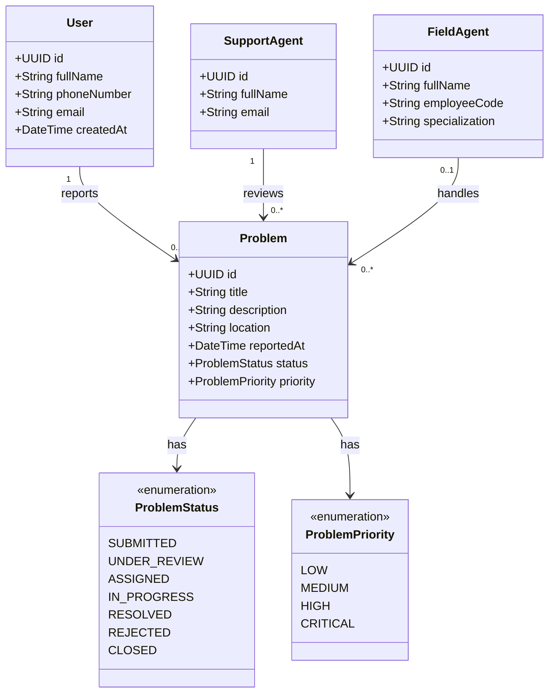

# Class Diagram — Problem Reporting System

## Overview

An initial domain model for a system that allows members
of a target community to report and track problems.

The target community is not finalized yet.

## Class Diagram

## Open Questions

- Who is the target user community?
- Can a problem have multiple field agents?
- Can a problem be reassigned?
- Are problem categories required?
- Is location mandatory for every problem?
- Can users comment on or reopen a problem?
- Should support agents and field agents share a common base class?
